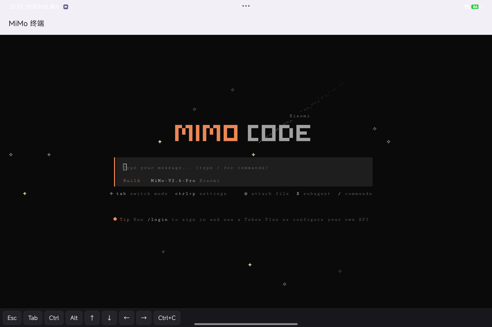
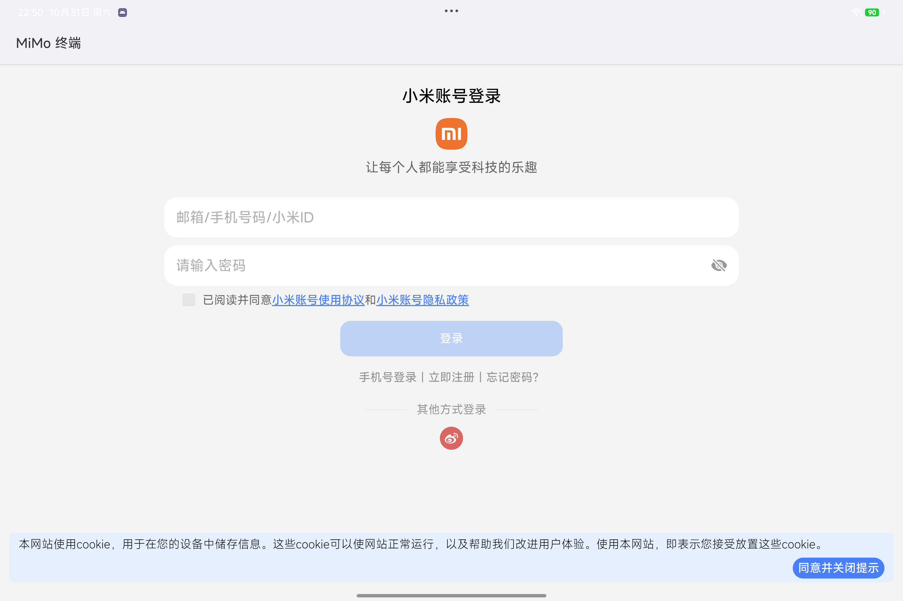

<p align="center">
  <a href="https://github.com/ShoW-ys/mimo-hyperos/actions/workflows/build.yml"></a>
  <a href="https://github.com/ShoW-ys/mimo-hyperos/releases/latest"></a>
  
  
  
  <a href="https://github.com/NousResearch/hermes-agent"></a>
</p>

# MiMo Terminal — MiMoCode on HyperOS 4 / Android arm64

[English](README.en.md) | [简体中文](README.md)

Packages Xiaomi's [MiMoCode](https://github.com/XiaomiMiMo/MiMo-Code) (`mimo`) into a sideloadable APK:
the APK ships an Ubuntu 24.04 rootfs plus the official `linux-arm64` binary, runs the glibc userland
inside `proot` **without root**, and exposes the untouched TUI over `127.0.0.1:<random port>` via `ttyd`.
The Android side is just a `WebView` plus a foreground service.

- Verified on: Xiaomi Pad 9 Pro Max (M367FC / yingtian), HyperOS 4.0, Android 17 (SDK 37), arm64-v8a, 4 KB pages
- APK size: ~75 MB (45 MB `mimo` + 29 MB rootfs)
- First launch needs network and takes 3–8 minutes (apt installs git / ripgrep / ttyd)

> Unofficial project. Not affiliated with or endorsed by Xiaomi. No Xiaomi trademarks or logos are used.

| MiMoCode TUI | In-app Xiaomi account login |
|---|---|
|  |  |

## Download

- Latest APK: [Releases](https://github.com/ShoW-ys/mimo-hyperos/releases/latest) (arm64, Android 8.0+)
- Verify: `sha256sum mimo-hyperos-v0.1.0-arm64.apk` →
  `d5274f9a0e722d5213ae49c43795f1619cb0d3d94c0b3641443cdcefd9c5b2d2`

## How it works

1. **Bundled rootfs.** The APK carries `ubuntu-base-24.04` (hard links flattened at build time — Android 17
   denies `link()` inside app data) and extracts it to app-private storage on first launch.
2. **proot instead of chroot.** `libproot.so` and its loader are packaged through `jniLibs`, so they land in
   `nativeLibraryDir` — the only place Android lets an app `execve()` from (W^X since Android 10).
   Guest binaries are never exec'd directly; proot's loader maps them.
3. **TUI over HTTP.** `ttyd` runs inside the guest and serves the real MiMoCode TUI on loopback, protected by
   a random port plus HTTP Basic auth. A `WebView` renders it; a key bar adds Esc / Tab / Ctrl / arrows.
4. **Login bridge.** `mimo` calls `xdg-open`; a shim in the guest writes the URL to a file that the app watches,
   and the app opens it in an in-app `WebView` (avoids HyperOS's cross-app launch prompt). The OAuth callback
   points at `localhost:<port>` inside the guest, which is the same loopback as Android, so login completes
   automatically.

## Build

```bash
source scripts/env.sh            # JDK 21 / SDK 36 / Gradle 8.13 (adjust paths as needed)
python scripts/fetch-runtime.py  # downloads + verifies rootfs / mimo / proot (written to assets & jniLibs, not in git)
./gradlew :app:testDebugUnitTest
./gradlew :app:assembleDebug
adb install -r app/build/outputs/apk/debug/app-debug.apk
```

`scripts/verify.sh` does install → launch → log assertions → 401/200 check in one shot.

Release signing reads `RELEASE_STORE_FILE` / `RELEASE_STORE_PASSWORD` / `RELEASE_KEY_ALIAS` /
`RELEASE_KEY_PASSWORD` from `local.properties` (gitignored). No key material lives in this repo.

## First launch

1. Open **MiMo 终端**, wait for the setup log (rootfs extraction happens once, ~1.2 GB).
2. MiMoCode asks for a "Quick safety check" → pick `Yes, I trust this folder` → Enter.
3. Run `/login` for a Token Plan, or `/connect` to configure your own API key.

The key bar at the bottom provides Esc / Tab / Ctrl / Alt / arrows / Ctrl+C; `Tab` switches build ↔ plan.

## Login with a Xiaomi account

Type `/login` (or `/connect`) in the TUI and pick `Xiaomi`:

1. `mimo` calls `xdg-open`; the shim installed by `setup-userland.sh` writes the authorize URL to
   `files/runtime/open-url`.
2. `RuntimeService` picks it up and opens the in-app `LoginActivity`, which loads the
   `account.xiaomi.com` login page — this avoids the HyperOS "launch another app?" confirmation.
3. After login Xiaomi redirects to `http://localhost:<port>/`, the listener `mimo` started inside the guest.
   Guest and Android share the loopback, so the callback lands and the TUI flips to signed-in.

The in-app page has a "Use browser" action for people whose Mi account is already signed in elsewhere.
The OAuth window is ~5 minutes; just run `/login` again if it expires.

## Known limitations

| Item | Notes |
|---|---|
| Plugins (bun ecosystem) | bun is not installed in the rootfs yet |
| LSP / formatters | disabled by default via `MIMOCODE_DISABLE_LSP_DOWNLOAD=1` |
| Drag & drop images | use `@` file references instead |
| System clipboard / notifications | long-press inside xterm.js works; native bridges are TODO |
| In-app login | cannot reuse the system Mi account (third-party apps can't hold the account SDK grant); first login needs the password, afterwards cookies remember it |

## Data and rollback

- Everything lives in `/data/user/0/io.github.showys.mimoandroid/files/` (rootfs, `~/.mimocode`, sessions).
- **Uninstalling wipes it all.** No root, no bootloader unlock, no changes to system partitions.
- Manual cleanup after removing the app: battery policy "unrestricted", autostart permission, USB/wireless debugging toggles.

## Project layout

```
app/src/main/java/io/github/showys/mimoandroid/
  MainActivity.kt        terminal WebView + key bar
  LoginActivity.kt       in-app OAuth login (WebView)
  RuntimeService.kt      foreground service: unpack / provision / start ttyd / URL bridge
  RuntimeInstaller.kt    asset extraction + rootfs unpack
  Runtime.kt / Proot.kt  proot argv and process management
  Prefs.kt               a few settings
app/src/main/assets/bootstrap/
  provision.sh           first run: mirrors, apt, mimo
  setup-userland.sh      every boot: xdg-open shim, etc.
  start-ttyd.sh          ttyd + mimo TUI
scripts/                 fetch-runtime.py / verify.sh / env.sh
docs/                    device audit, troubleshooting, install/uninstall test log
```

Measured: uninstall leaves nothing behind, cold start after a clean install is 68 s, `install -r` restarts in
2–3 s with data preserved (see `docs/install-test.md`).

## License

Project code is MIT (see `LICENSE`). Third-party components bundled into the APK are listed in
`THIRD_PARTY_NOTICES.md` — notably Termux `proot` (GPLv2), so redistributing the APK requires offering its
corresponding source. No Xiaomi trademarks or logos are used.
