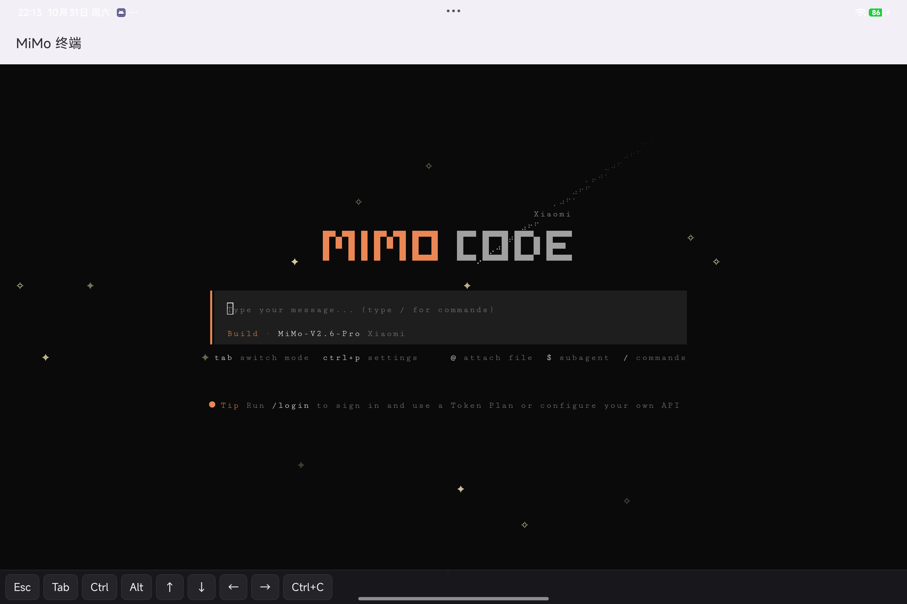
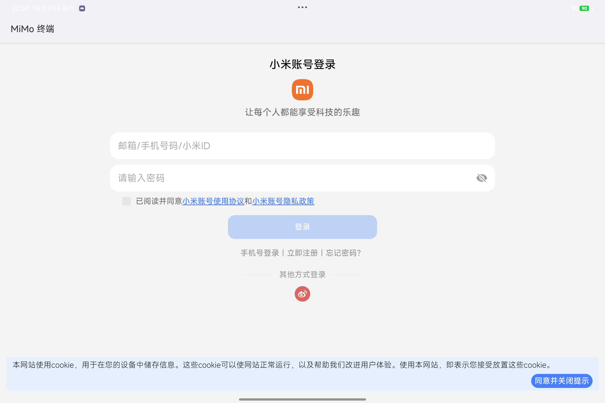

<p align="center">
  <a href="https://github.com/ShoW-ys/mimo-hyperos/actions/workflows/build.yml"></a>
  <a href="https://github.com/ShoW-ys/mimo-hyperos/releases/latest"></a>
  
  
  
  <a href="https://hermes-agent.nousresearch.com/"></a>
</p>

# MiMo 终端（MiMoCode for HyperOS 4 / Android arm64）

简体中文 | [English](README.en.md)

把小米 MiMoCode（`mimo`）打包成可侧载安装的 APK：APK 内自带 Ubuntu 24.04 rootfs + MiMoCode 二进制，
用 `proot` 在无 root 的 Android 上跑 glibc 用户态，`ttyd` 把原版 TUI 暴露在 `127.0.0.1:<随机端口>`，
Android 侧只有一个 WebView + 前台服务。

- 已验证设备：小米平板 9 Pro Max（M367FC / yingtian），HyperOS 4.0，Android 17（SDK 37），arm64-v8a，PAGE_SIZE 4096
- APK 大小：约 75 MB（含 45 MB mimo + 29 MB rootfs）
- 首次启动需联网，3–8 分钟（apt 装 git / ripgrep / ttyd）

> 非官方项目：与小米公司无隶属或背书关系，不使用小米商标与 Logo。

| 原版 TUI | 应用内小米账号登录 |
|---|---|
|  |  |

## 下载

- 最新 APK：[Releases](https://github.com/ShoW-ys/mimo-hyperos/releases/latest)（arm64，Android 8.0+）
- 校验：`sha256sum mimo-hyperos-v0.1.0-arm64.apk` → `d5274f9a0e722d5213ae49c43795f1619cb0d3d94c0b3641443cdcefd9c5b2d2`

## 构建

```bash
source scripts/env.sh          # JDK21 / SDK36 / Gradle 8.13（路径按需修改）
python scripts/fetch-runtime.py # 下载并校验 rootfs / mimo / proot（会写 assets 与 jniLibs，不进 git）
gradle :app:testDebugUnitTest
gradle :app:assembleDebug
adb install -r app/build/outputs/apk/debug/app-debug.apk
```

`scripts/verify.sh` 一条命令完成「装 + 起 + 日志断言 + 401/200 校验」。

## 首次启动

1. 打开「MiMo 终端」，等日志跑完（首次会解包 1.2 GB rootfs）。
2. 终端里出现 MiMoCode 的「Quick safety check」→ 方向键选 `Yes, I trust this folder` → 回车。
3. `/login` 登录 Token Plan，或 `/connect` 配置自己的 API Key。

底部工具条提供 Esc / Tab / Ctrl / Alt / 方向键 / Ctrl+C；`Tab` 切换 build/plan。

## 登录小米账号

终端里输入 `/login`（或 `/connect`）→ 选 `Xiaomi`：

1. guest 里的 `mimo` 会调用 `xdg-open`（rootfs 里由 `setup-userland.sh` 提供 shim），
   把授权 URL 写进 `files/runtime/open-url`；
2. `RuntimeService` 监听到新 URL → 打开 **应用内 `LoginActivity`**（WebView 加载
   `account.xiaomi.com` 登录页，不触发 HyperOS 的「链式启动」确认框）；
3. 登录完成后小米重定向到 `http://localhost:<port>/`，该端口就是 guest 里 mimo 起的回调服务，
   与 Android 共用 loopback，回调自动完成，TUI 直接进入已登录状态。

登录页右上角「改用浏览器」会走系统浏览器（首次会弹 HyperOS 的「启动应用」确认，
选「始终允许」以后不再询问）。注意 OAuth 等待约 5 分钟，超时后重跑 `/login` 即可。

## 已知限制

| 项 | 说明 |
|---|---|
| 插件（bun 生态） | 未装 bun |
| LSP / 格式化 | `MIMOCODE_DISABLE_LSP_DOWNLOAD=1` 默认关闭 |
| 拖拽图片 | 用 `@` 引用文件路径代替 |
| 系统剪贴板/通知 | xterm.js 内长按可选；系统级桥接待做 |
| 应用内登录页 | 与系统「小米账号」不通（第三方 APK 拿不到账号 SDK 权限），首次需输密码，之后靠 Cookie 记住 |

## 数据与回退

- 全部数据在 `/data/user/0/io.github.showys.mimoandroid/files/`（rootfs、`~/.mimocode`、会话）。
- **卸载 APK 即清空**；不改系统分区、不 root、不解锁 BL。
- 需要手动还原的只有：电池策略「无限制」、自启动授权、USB/无线调试开关。

## 项目结构

```
app/src/main/java/io/github/showys/mimoandroid/
  MainActivity.kt        终端 WebView + 键盘工具条
  LoginActivity.kt       应用内 OAuth 登录（WebView）
  RuntimeService.kt      前台服务：解包 / 首配 / 起 ttyd / URL 桥
  RuntimeInstaller.kt    资产释放 + rootfs 解包
  Runtime.kt / Proot.kt  proot 参数与进程管理
  Prefs.kt               少量设置
app/src/main/assets/bootstrap/
  provision.sh           首配：源、apt、mimo
  setup-userland.sh      每次启动：xdg-open shim 等
  start-ttyd.sh          ttyd + mimo TUI
scripts/                 fetch-runtime.py / verify.sh / env.sh
docs/                    设备审计、排障、安装卸载实测
```

已实测：卸载无残留、全新安装冷启动 68 s、覆盖安装 2–3 s 且数据保留（见 `docs/install-test.md`）。

## 许可证

本项目代码 MIT（`LICENSE`）；打包进 APK 的第三方组件见 `THIRD_PARTY_NOTICES.md`
（其中 Termux `proot` 为 GPLv2，分发 APK 时须一并提供其源码链接）。不使用小米商标/Logo。
